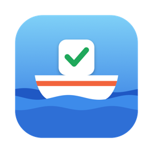

<p align="center"></p>

# TaskFerry

A macOS app that copies your open Apple Reminders into Todoist, one list at a time, and then reads everything back to check that it arrived intact.

TaskFerry is an independent project. It is not affiliated with, or endorsed by, Apple or Doist.

## What it does

1. **Connect.** You allow access to Reminders and paste a Todoist API token.
2. **Choose lists.** Tick the Reminders lists (and groups of lists) you want to move.
3. **Preview.** You see exactly which projects, sections, tasks and alerts would be created, what already exists in Todoist, and anything that cannot be carried over cleanly.
4. **Migrate.** The app creates everything in Todoist, then compares each task with its reminder field by field.
5. **Finish (optional).** When the check is clean, you can mark the migrated reminders as completed in Apple Reminders.

Nothing in Apple Reminders is ever deleted. The only change the app can make there is step 5, and only when you ask.

## Why a run is safe to repeat

- **A record of every item.** Each created project, section, task and alert is written to a ledger file straight away. If the app quits, your Mac sleeps or the network drops, start again: the run continues where it stopped.
- **No duplicates.** Before creating anything the app compares the plan with the ledger and with what is already in Todoist. A task that is already there is recognised rather than created twice, even if the ledger has been lost.
- **Completed tasks stay completed.** A task you have since completed in Todoist is not recreated on a later run.
- **Verification.** After a run, and whenever you click "Check against Todoist", every task is read back and compared: title, description, priority, due date, project, section, parent and alerts.
- **Rate limits and errors.** Requests are paced, rate-limit and server errors are retried with a back-off, and a failure stops the run with a message instead of skipping items.

## What is carried over

| In Apple Reminders | In Todoist |
|---|---|
| List | Project |
| Group of lists | Parent project containing the list projects (from the mapping file) |
| Title | Task name |
| Notes | Task description |
| URL field | Appended to the description, unless it is already in the title or notes |
| Due date, with or without a time | Due date; a time keeps its exact moment across time zones |
| Priority (high, medium, low) | p1, p2, p3 |
| Time-based alert | Reminder on the task |
| Repeat rule | Recurring due date written as Todoist text, for example "every 2 weeks" |
| Start date, when different from the due date | A "Start: …" line in the description |
| Section | Section (from the mapping file) |
| Subtask | Subtask (from the mapping file) |
| Link preview chip | Link in the description (from the mapping file) |

## What is not carried over

- **Completed reminders.** Only open reminders are migrated.
- **Tags and flags.** Apple's Reminders API does not expose them.
- **Images and other attachments.**
- **Location alerts.** They are noted in the task description; no Todoist location reminder is created.
- **Alerts whose time has already passed.** They could never fire, so they are skipped.
- **Assignments and other shared-list details.**

## The mapping file

Apple's API (EventKit) gives apps a flat list of reminders per list. It does not say which lists are in a group, which section a reminder is in, which reminders are subtasks, or what a link preview points to. TaskFerry can carry those over if you describe them in a small JSON file:

```
~/Library/Application Support/TaskFerry/mapping.json
```

The "Open mapping folder" button on the Choose lists screen opens that folder. Copy [`Examples/mapping.example.json`](Examples/mapping.example.json) there as `mapping.json`, edit it, and restart the app.

| Key | Meaning |
|---|---|
| `inboxLists` | Names of Reminders lists whose reminders go into the Todoist Inbox instead of a new project. |
| `groups` | Each group becomes a parent project; its `lists` become sub-projects. |
| `sections` | For one `list`, a section `name` and the `reminders` that belong in it. |
| `subtasks` | For one `list`, a `parentTitle` and its `children`. If no open reminder has that title (for example the parent is completed), a parent task is created. |
| `links` | For one `list`, the `reminder` that has a link preview and the `url` it points to. |

Reminders are picked out by title, ignoring case and extra spaces:

- `{ "contains": "some words" }` matches a title containing that text.
- `{ "exact": "X" }` matches a title that is exactly that text. Use it for very short titles.

An entry must match exactly one open reminder in its list. If it matches none or several, the app does not guess: it leaves that reminder as an ordinary task and lists the entry under "things to know before migrating" in the preview.

The file is optional. Without it, every list becomes a top-level project and every reminder a top-level task.

## Requirements

- macOS 14 or later.
- Xcode 15 or later, or its command line tools, to build.
- A Todoist account and its API token (Todoist → Settings → Integrations → Developer).
- Alerts become Todoist reminders, which need a Todoist plan that includes reminders. On other plans the tasks are still migrated and the missing alerts are reported.

Developed and tested on macOS 27 against the Todoist API v1.

## Build and run

```bash
git clone https://github.com/andyjenkins1/taskferry.git
cd taskferry
./scripts/build-app.sh
open build/TaskFerry.app
```

The script builds a release binary, wraps it in `build/TaskFerry.app` and signs it. If your keychain has an "Apple Development" certificate, the app keeps a stable identity and macOS remembers its Reminders permission between rebuilds. Otherwise it is signed ad hoc and macOS asks again after each rebuild.

There is no pre-built download: the app is not notarised, so build it yourself.

## Using it

1. Open the app, click **Allow access to Reminders**, and approve the macOS prompt.
2. Paste your Todoist API token and click **Connect**.
3. On **Choose lists**, tick what you want to move. To keep the result separate from your existing projects, name a project to put everything inside.
4. On **Preview**, read the summary and the list of things to know. Items marked "new" will be created; items marked "exists in Todoist" or "already migrated" are left alone.
5. On **Migrate**, click **Start migration**. When it finishes, read the "Check against Todoist" result.
6. Wait a few minutes and click **Check against Todoist** again. Todoist rewrites bare web addresses into titled links shortly after a task is created; the check allows for that.
7. When every task matches, **Mark migrated reminders as completed in Reminders** is offered. It affects only reminders that were migrated and matched in the last check.

Try one small list first.

### Existing Todoist projects

If Todoist already has a project with the same name at the same level, TaskFerry adds to it rather than creating a second one. The preview shows this as "exists in Todoist".

## Files on your Mac

| What | Where |
|---|---|
| Ledger of migrated items | `~/Library/Application Support/TaskFerry/ledger.json` |
| Mapping file (optional) | `~/Library/Application Support/TaskFerry/mapping.json` |
| Todoist API token | macOS Keychain, service `io.github.andyjenkins1.taskferry` |

The ledger is tied to one Todoist account. "Reset migration history" clears it; that makes the app forget what it migrated, it does not remove anything from Todoist.

## Privacy and security

- The app talks only to `https://api.todoist.com`. There is no analytics, telemetry or other network use.
- The API token is stored in the macOS Keychain, never in a file or in this repository.
- Your reminders are read on your Mac and sent only to your own Todoist account.

## Limitations

- **Repeat rules** are converted for simple cases (every day, every N weeks, named weekdays). Rules with end dates or month-day patterns are flagged in the preview for you to review. This conversion is covered by unit tests but has not yet been exercised against a live Todoist account.
- **Titles.** Todoist task names are one line of at most 500 characters. Line breaks become spaces, and a longer title is shortened with the full text kept in the description.
- **"@word" in a title.** Todoist reads it as a label when a task is created. TaskFerry notices and restores the title.
- **Mapping by title.** Groups, sections, subtasks and link previews depend on the mapping file being kept in step with Reminders.
- **Time zones.** The check assumes your Mac and your Todoist account use the same time zone.

## Troubleshooting

- **No permission prompt, or access shows as turned off.** Open System Settings → Privacy & Security → Reminders and switch TaskFerry on, then click "Check again".
- **"Todoist rejected the API token."** Paste the token again; make sure there are no spaces around it.
- **"The migration history on this Mac belongs to a different Todoist account."** The ledger was created with another account. Use "Reset migration history" only if you mean to migrate into the new account.
- **Differences reported straight after a run.** Run the check again after a few minutes. Anything still listed is a real difference and names the field.

## Development

```bash
swift test
```

The logic lives in `Sources/TaskFerryCore` and has no dependency on EventKit or SwiftUI, so it is tested against an in-memory stand-in for Todoist, including a failure injected at every possible point of a run. `Sources/TaskFerry` holds the EventKit reader, Keychain access and the SwiftUI window.

Two launch arguments help when working on the app:

```bash
# Build the plan for every list and write a summary. Sends nothing to Todoist.
open -W build/TaskFerry.app --args --dry-run "$PWD/dry-run.txt"

# Open the Migrate screen filled with sample values, to check its layout.
open build/TaskFerry.app --args --layout-check
```

The icon is drawn by `scripts/make-icon.swift`; run `./scripts/make-icon.sh` to regenerate `Resources/AppIcon.icns`.

## Licence

MIT. See [LICENSE](LICENSE).
